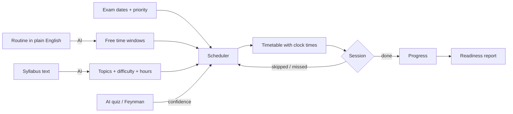

# StudyGPT 📚✨

### An AI-powered study planner that builds your timetable and rebuilds it when life gets in the way.

StudyGPT generates a **personalized study schedule** from your **exam dates**, **syllabus**, and **available time**.

- **Describe your week in plain English.** The AI finds your free slots.
- **Paste your syllabus.** The AI breaks it into topics.
- **Get a timetable with real clock times.** It puts the most urgent, hardest and weakest topics first.
- **Skip a session, fail a quiz, or finish early.** The plan re-adjusts itself.

> **Problem statement:** *AI-Powered Study Planner: a smart application that generates personalized study schedules based on exam dates, subjects, and available time.*

---

## 🎬 Demo

- ▶️ **Demo video (≈3 min):** [docs/demo/studygpt-demo.mp4](https://cdn.jsdelivr.net/gh/26z216-stack/Study-GPT@main/docs/demo/studygpt-demo.mp4)
- 📄 **Screenshots (PDF):** [docs/demo/studygpt-screenshots.pdf](https://cdn.jsdelivr.net/gh/26z216-stack/Study-GPT@main/docs/demo/studygpt-screenshots.pdf)

---

## ✨ Features

### Planning (the core)
| | Feature | What it does |
|---|---|---|
| 🧠 | **Personalized timetable** | Fills each day with 30–60 min study blocks, ranked by exam urgency, difficulty, priority and how well you know each topic. |
| 🗣️ | **AI routine parser** | *"College 9–4, gym 6–7pm Mon/Wed/Fri, I focus best in the mornings, Sunday lunch 12–3"* becomes free study windows, so every session gets a real start and end time. |
| 🔄 | **Automatic rescheduling** | Missed or skipped sessions are redistributed into upcoming days. The plan also rebuilds when your syllabus, free time or quiz scores change. |
| 🎯 | **Difficulty + priority** | Subjects have a priority (1–5), and subjects and topics have a difficulty (1–5). Both feed straight into the scheduling score. |
| 📚 | **Syllabus tracker** | Track topics by status, hours needed and confidence. **Paste a syllabus and the AI splits it into topics**, with a difficulty and time estimate for each. |
| 📝 | **Exam-eve revision** | The day before each exam gets a revision block on that subject's weakest topic. |

### Active learning
| | Feature | What it does |
|---|---|---|
| 🤖 | **AI quiz generator** | 5 MCQs per topic with explanations. Your score updates the topic's confidence, and the timetable re-prioritises. |
| 🃏 | **Flashcards** | AI-generated or written by you. |
| 🔁 | **Spaced repetition** | SM-2 algorithm (Again / Hard / Good / Easy, keyboard 1–4). Cards you know come back less often. |
| 🧠 | **Feynman Technique** | Explain a topic in simple words. The AI finds your gaps, misconceptions and unexplained jargon, suggests an analogy, and scores your understanding. |

### Insight & support
| | Feature | What it does |
|---|---|---|
| 📊 | **Exam readiness report** | Readiness per subject and overall, study hours logged, plan adherence, plus an AI analysis of what to focus on in the next 3 days. |
| 💬 | **AI study coach** | A chatbot that knows your actual subjects, exam dates, timetable and weak topics. |
| ⏱️ | **Focus timer** | Pomodoro / deep-work timer linked to a planned session. It survives page reloads and tab switches. |
| 📅 | **Calendar export** | Download the timetable and exams as `.ics` for Google Calendar, Outlook or Apple Calendar. |
| 🎨 | **Light / dark theme** · 💬 **Daily quote** · 📱 **Mobile layout** | |

---

## 🧮 How the planner decides

The schedule itself is built by a **deterministic algorithm**, not by the AI. It never over-books a day, never schedules a subject after its exam, and every decision can be explained. The AI is used where it's strongest: understanding your routine and syllabus, generating questions, giving feedback, and coaching.

```
score(topic, day) = urgency × (topic difficulty + subject priority) × (1 − confidence)

urgency         = 1 / days until that subject's exam
work remaining  = estimated hours × (1 − confidence) − minutes already studied
```

1. Each day is filled greedily, up to that day's free time, with the highest-scoring topic.
2. Scores are recomputed after every block, and a topic already studied that day is penalised, so subjects **interleave** instead of you cramming one topic.
3. Blocks are laid into your **free windows** with 10-minute breaks, which gives them real clock times.
4. **Feedback loop:** quiz and Feynman scores change a topic's confidence, which changes its score, which changes tomorrow's plan.



---

## 🛠️ Tech stack

| Layer | Choice |
|---|---|
| Backend | Python 3, Flask 3, Flask-Login, Flask-WTF (CSRF) |
| Database | SQLite via Flask-SQLAlchemy (swap in Postgres with `DATABASE_URL`) |
| AI | Google Gemini 2.5 Flash (REST, JSON output) |
| Frontend | Jinja templates, vanilla JavaScript, responsive CSS (sidebar on desktop, bottom nav on mobile) |
| Tests | Python `unittest` |

---

## 🚀 Getting started

### 1. Install
```bash
git clone https://github.com/26z216-stack/Study-GPT.git
cd Study-GPT
python -m venv .venv
.venv\Scripts\activate            # Windows
# source .venv/bin/activate       # macOS / Linux
pip install -r requirements.txt
```

### 2. Configure
Copy `.env.example` to `.env` and add a Gemini API key. A free key is available from [Google AI Studio](https://aistudio.google.com/apikey).
```env
SECRET_KEY=any-long-random-string
GEMINI_API_KEY=your-key-here
FLASK_DEBUG=true
```
Without a key, the planner, tracker, timetable, flashcard reviews and timer still work. Only the AI features are disabled.

### 3. (Optional) Load demo data
```bash
python seed_demo.py
```
This creates the account **`demo@studygpt.app` / `demo123`**, with 3 subjects, 15 topics, a weekly routine, some study history (including a missed session that has been auto-rescheduled) and flashcards that are due.

### 4. Run
```bash
python start.py
```
Open **http://localhost:5000**.

---

## 🧭 Using StudyGPT

1. **Sign up**, then add your **subjects** with exam dates, difficulty and priority.
2. Open a subject and **paste its syllabus**. The AI creates the topics (or add them by hand).
3. **Describe your routine** in plain words, or set your free hours per day with the sliders.
4. Open **Today**. Follow the plan: start the focus timer, then mark sessions **Done** or **Skip** them.
5. On any topic, take an **AI quiz**, make **flashcards**, or try the **Feynman** explanation. Your plan adapts to how you do.
6. Check the **Report** for your exam readiness, and ask the **Coach** anything about your plan.

---

## 🧪 Tests

```bash
python -m unittest discover -s tests -t .
```

The tests cover the scheduler, clock-time placement, spaced repetition, readiness scoring, and an end-to-end run through every page with the AI stubbed out.

---

## 📁 Project structure

```
Study-GPT/
├── start.py                 # entry point
├── seed_demo.py             # demo account + data
├── requirements.txt
├── Procfile                 # gunicorn command for Render / Railway
├── studygpt/
│   ├── __init__.py          # app factory
│   ├── models.py            # User, Subject, Topic, Availability, StudySession, QuizAttempt, Flashcard, ...
│   ├── scheduler.py         # the planning algorithm (pure Python)
│   ├── clock.py             # lays sessions into free time windows
│   ├── srs.py               # SM-2 spaced repetition
│   ├── readiness.py         # exam readiness score
│   ├── plan_service.py      # DB ↔ scheduler glue, auto-rescheduling, AI context
│   ├── ai.py                # Gemini prompts: routine, syllabus, quiz, flashcards, Feynman, coach, report
│   ├── planner.py           # dashboard, subjects, syllabus, timetable, report, focus routes
│   ├── learn.py             # quiz, flashcards, review, Feynman routes
│   ├── coach.py             # AI coach chat
│   ├── auth.py              # sign up / log in
│   ├── templates/           # Jinja pages
│   └── static/              # CSS, JS, focus timer core
├── tests/
└── docs/                    # design spec
```

---

## ☁️ Deploying

The included `Procfile` works on Render, Railway and similar platforms:

```
web: gunicorn start:app --timeout 120 --workers 1 --threads 4
```

Set `SECRET_KEY` and `GEMINI_API_KEY` in the host's environment settings. For persistent data, point `DATABASE_URL` at a Postgres database and add `psycopg2-binary` to `requirements.txt`.

---

## 🗺️ Roadmap

- Two-way Google Calendar sync (currently one-way `.ics` export)
- Upload syllabus PDFs directly
- Push notifications for upcoming sessions
- Study groups with shared plans
